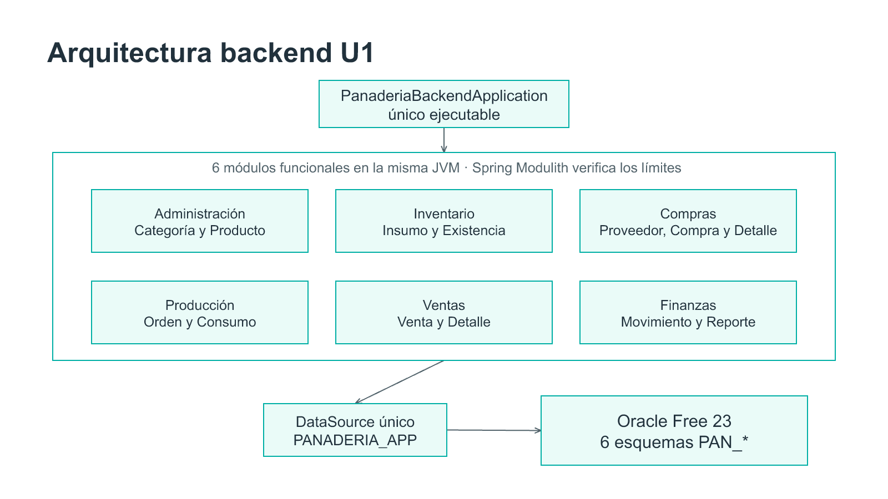

# LP2 · Producto de Unidad 1 — Panadería

**Proyecto:** Sistema de Gestión de Producción y Comercialización de Productos de Panificación  
**Grupo e integrantes:** completar antes de la sustentación  
**Corte:** backend REST, sin frontend ni JWT

Este documento adapta la estructura de la plantilla de BomERP al backend real de `panaderia-backend`. La figura, el contrato y las pruebas corresponden al código y al entorno local comprobados el 15 de septiembre de 2026. El alcance implementado supera el ejemplo de dos módulos: Administración, Inventario, Compras, Producción, Ventas y Finanzas ya tienen contenido funcional.

## 1. Alcance arquitectónico del corte

Un solo proyecto Maven produce una aplicación Spring Boot ejecutable, `PanaderiaBackendApplication`, en el puerto 8081. Spring Modulith verifica los límites de los paquetes de negocio mediante `ModularityTests`. Los seis módulos corren en la misma JVM y comparten un `DataSource` hacia Oracle Free 23. No hay comunicación HTTP interna ni proyectos Maven independientes por módulo.

```text
src/main/java/pe/edu/upeu/panaderia/
├── PanaderiaBackendApplication.java
├── administracion/     categoria, producto
├── inventario/         insumo, existencia
├── compras/            proveedor, compra, detalle de compra
├── produccion/         orden de producción, detalle de consumo
├── ventas/             venta, detalle de venta, reporte
├── finanzas/           movimiento financiero, reporte
├── config/             CORS
├── exception/          respuestas de error
└── filter/             X-Trace-ID
```

Cada módulo mantiene controladores, DTO, servicios, entidades y repositorios propios. Las operaciones que cruzan módulos llaman servicios públicos. Compras y Ventas son operaciones de cabecera y detalles persistidas en forma atómica. Producción registra órdenes **ya completadas**; en este corte no ofrece anulación. JWT y frontend quedan para la siguiente unidad.

## 2. Demo ejecutable

La demostración usa la **API real conectada a Oracle**, no una simulación en el navegador. Arranque desde la carpeta `panaderia-backend`:

```powershell
docker compose -f compose-dev.yml up -d
docker compose -f obs/compose-dev.yml up -d
.\mvnw.cmd spring-boot:run
```

`application.yml` activa el perfil `dev`. Oracle se publica en el puerto local 1531; el backend, en 8081; Prometheus, en 39090. Comprobar [salud](http://localhost:8081/actuator/health), [Swagger](http://localhost:8081/swagger-ui/index.html) y [Prometheus Targets](http://localhost:39090/targets). La observabilidad es un anexo opcional: recoge métricas agregadas de las peticiones HTTP cada 15 segundos, no el cuerpo de cada solicitud ni el SQL.

## 3. Contrato REST del proyecto

| Método | Endpoint | Comportamiento verificable |
|---|---|---|
| GET, POST, PUT, DELETE | `/api/v1/categorias` y `/{id}` | CRUD de categorías. |
| GET, POST, PUT, DELETE | `/api/v1/productos` y `/{id}` | CRUD de productos asociados a categoría; listado con `nombre`, `categoriaId`, `precioMin`, `precioMax`. |
| GET, POST, PUT, DELETE | `/api/v1/insumos` y `/{id}` | CRUD de materias primas; valida stock y nombre. |
| GET | `/api/v1/existencias`, `/producto/{productoId}` | Consulta stock del producto terminado. |
| GET, POST, PUT, DELETE | `/api/v1/proveedores` y `/{id}` | CRUD; RUC único y estado `activo`. |
| POST, GET | `/api/v1/compras`, `/{id}` | Compra con proveedor y detalles; aumenta stock de insumos, calcula total y crea egreso financiero. |
| PATCH | `/api/v1/compras/{id}/anular` | Revierte la entrada de insumos y anula el egreso; conserva compra y detalles. |
| POST, GET | `/api/v1/ordenes-produccion`, `/{id}` | Registra orden completada, consume insumos y repone pan. |
| POST, GET | `/api/v1/ventas`, `/{id}` | Venta local o de exportación con detalles; descuenta pan, calcula total y crea ingreso financiero. |
| PATCH | `/api/v1/ventas/{id}/anular` | Repone pan y anula el ingreso; conserva venta y detalles. |
| GET | `/api/v1/ventas/resumen`, `/api/v1/reportes/ventas` | Cuenta y suma solo ventas `REGISTRADA`, con fechas opcionales. |
| GET | `/api/v1/movimientos-financieros`, `/{id}` | Lista o consulta ingresos y egresos históricos. |
| GET | `/api/v1/reportes/finanzas` | Cuenta y suma movimientos `ACTIVO`; saldo = ingresos − egresos. |

El listado de ventas acepta `tipo`, `estado`, `fechaDesde`, `fechaHasta`, `paisDestino`, `productoId` y `ordenFecha`. Los filtros son combinables. Las rutas usan `/api/v1`; Swagger expone el contrato OpenAPI en `/v3/api-docs`. La API devuelve `X-Trace-ID` para relacionar peticiones con logs. El controlador global transforma errores de validación, inexistencia y conflicto en 400, 404 y 409.

## 4. DTO principales y reglas

**Producto relacionado.** `ProductoRequest` contiene `nombre`, `precio` y `categoriaId`; `ProductoResponse` devuelve un resumen de la categoría, sin exponer la entidad JPA completa. El servidor valida nombre, precio y categoría existente.

**Compra con cabecera y detalles.** El cliente envía proveedor e insumos; el servidor fija fecha, estado, subtotales y total:

```json
{
  "proveedorId": 1,
  "detalles": [{"insumoId": 1, "cantidad": 10, "precioUnitario": 2.50}]
}
```

Una compra real devolvió `id: 1`, `estado: REGISTRADA`, `total: 25` y aumentó la harina de 50 a 60. Si un segundo insumo no existe, la API responde 404 y la transacción revierte el aumento del primer detalle.

**Venta con cabecera y detalles.** `tipo` admite `LOCAL` o `EXPORTACION`; exportación exige `paisDestino` y venta local lo omite:

```json
{
  "tipo": "LOCAL",
  "paisDestino": null,
  "detalles": [{"productoId": 1, "cantidad": 2}]
}
```

La respuesta conserva nombres y precios históricos de los detalles y devuelve `fecha`, `estado`, `total` y subtotales calculados. La venta local real `id: 1` tuvo total 8. La venta de exportación `id: 2`, destino Chile, tuvo total 12 y luego se anuló; su cabecera y detalles permanecen.

**Producción.** `OrdenProduccionRequest` contiene `productoId`, `cantidadProducida` y `insumos[]` con `insumoId` y `cantidadConsumida`. La orden real `id: 1` produjo 10 panes consumiendo 5 unidades de harina; el estado devuelto fue `COMPLETADA`.

## 5. Arquitectura backend U1



**Figura 1. Arquitectura backend U1 de Panadería.** Una sola aplicación expone los seis módulos. Administración provee categorías y productos; Inventario mantiene insumos y existencias; Compras y Ventas coordinan sus respectivas transacciones; Producción transforma insumos en producto terminado; Finanzas recibe movimientos de Compras y Ventas. Los módulos usan un solo datasource técnico hacia tablas de seis esquemas Oracle: `PAN_ADMINISTRACION`, `PAN_INVENTARIO`, `PAN_COMPRAS`, `PAN_PRODUCCION`, `PAN_VENTAS` y `PAN_FINANZAS`.

El flujo de negocio que conviene narrar con la figura es: compra de harina, aumento de insumos, orden completada, aumento de existencias de pan, venta local o de exportación, ingreso y egreso financieros. `@Transactional` agrupa stock, cabecera, detalles y movimiento: una excepción antes del commit produce rollback completo. Las anulaciones invierten el stock afectado y marcan el movimiento como `ANULADO`; no borran el histórico. En producción no hay anulación en este alcance.

## 6. Casos de prueba y evidencia

| Caso | Acción de demo | Resultado esperado y evidencia disponible |
|---|---|---|
| Arranque real | `GET /actuator/health` | HTTP 200, `UP`, Oracle `UP`; comprobado en el entorno local. |
| Límite modular | `.\mvnw.cmd clean test` | `ModularityTests` verifica dependencias de módulos. Último resultado completo: **187 pruebas, 0 fallos, 0 errores, 0 omitidas**. |
| CRUD y asociación | Crear/listar producto con `categoriaId: 1` | Producto `Pan Integral Artesanal`, precio 4, categoría `Panes`; validación inválida 400 e ID inexistente 404 comprobados. |
| Cabecera y detalles de compra | `POST /api/v1/compras` con harina | Compra 1, total 25; stock de harina pasó de 50 a 60; egreso activo generado. |
| Rollback de compra | Primer detalle válido, segundo `insumoId: 999999` | HTTP 404; la compra no se registra y el primer aumento de stock se revierte. |
| Cabecera y detalles de venta | `POST /api/v1/ventas` con 2 panes | Venta local 1, total 8; descuento de existencias e ingreso activo. |
| Rollback de venta | Dos detalles, segundo con stock insuficiente | HTTP 409; stock quedó en 100 y la lista de ventas en `[]` durante la prueba inicial. |
| Producción completada | Orden 1, 10 panes, 5 unidades de harina | Harina pasó de 60 a 55; pan de 98 a 108; orden `COMPLETADA`. |
| Anular venta | `PATCH /api/v1/ventas/2/anular` | Venta 2 `ANULADA`; pan repuesto; ingreso excluido de reportes activos. |
| Anular compra | `PATCH /api/v1/compras/{id}/anular` | Insumos de sus detalles descontados; egreso `ANULADO`; operación rechazada con 409 si falta stock. |
| Filtros y agregaciones | Filtrar productos/ventas; consultar reportes | Producto filtrado por nombre/categoría/precio; exportación a Chile filtrada por fecha y país. Reporte financiero actual: ingresos 8, egresos 25, saldo −17. |
| Observabilidad | Consultar Prometheus | Objetivo `panaderia-backend` `UP`; contador `http_server_requests_seconds_count` registra rutas de la API. |

Estas cifras proceden de pruebas manuales realizadas durante el desarrollo y de consultas **de solo lectura** al entorno local el 15 de septiembre de 2026. Para una sustentación repetible, usar registros temporales nuevos y anotar los IDs devueltos: los IDs de producción, compras y ventas pueden cambiar. La demo técnica debe comprobar el stock antes y después del rollback.

## 7. Trazabilidad con ADS y BD2

| Elemento LP2 | Vista ADS que debe mostrar el grupo | Evidencia BD2 en este backend |
|---|---|---|
| Monolito modular | Vista C3 con seis límites y servicios públicos | Seis esquemas Oracle funcionales; entidad JPA con `@Table(schema=...)`. |
| Producto y categoría | Relación maestro y referencia controlada | `PAN_ADMINISTRACION.CATEGORIAS` y `PRODUCTOS`; FK de categoría. |
| Compra de insumos | Cabecera, detalles y regla de stock | `PAN_COMPRAS.COMPRAS`, `DETALLE_COMPRAS`; `PAN_INVENTARIO.INSUMOS`. |
| Producción completada | Consumo de insumos y salida de producto | `PAN_PRODUCCION.ORDENES_PRODUCCION`, `DETALLES_CONSUMO`; `PAN_INVENTARIO.EXISTENCIAS`. |
| Venta local/exportación | Cabecera, detalles, estado y precio histórico | `PAN_VENTAS.VENTAS`, `DETALLE_VENTAS`; restricción de existencias. |
| Finanzas automáticas | Regla ingreso/egreso y anulación histórica | `PAN_FINANZAS.MOVIMIENTOS_FINANCIEROS`, origen único por documento. |
| Integridad transaccional | Commit, rollback y concurrencia | `@Transactional` y bloqueos pesimistas de stock/documento; restricciones de datos en Oracle. |

El grupo debe adjuntar sus diagramas ADS y los artefactos BD2 definitivos para convertir esta relación en trazabilidad formal. Aquí se identifican correspondencias comprobables en código y SQL, sin atribuir al grupo documentos ADS que no se proporcionaron.

## 8. Preparación para la rúbrica y la sustentación

| Criterio | Evidencia preparada | Punto que falta comprobar o mejorar |
|---|---|
| 1. Proyecto, ORM, Oracle, REST, DTO, API | Spring Boot 4, Oracle `UP`, `/api/v1`, DTO y Swagger en vivo. | La configuración `dev` contiene credenciales locales en el repositorio; antes de publicar, llevarlas a variables de entorno y documentar la instalación. |
| 2. CRUD, errores, logs, pruebas | Categorías/productos/insumos/proveedores; 400/404/409; `X-Trace-ID`; 187 pruebas verdes. | Mostrar en vivo un caso válido y uno inválido. |
| 3. ORM y objetos relacionados | Producto con resumen de categoría; compras y ventas con detalles históricos. | Mostrar DTO y entidad JPA sin navegar referencias en círculo. |
| 4. Cabecera-detalle y rollback | Compra y venta atómicas; casos 201, 404/409; stock antes/después. | Repetir una prueba de rollback durante la demo con datos temporales. |
| 5. Consultas, reportes, CORS | Filtros combinables, resumen de ventas, reporte financiero, CORS para `localhost:4200`. | El origen CORS está escrito en `CorsConfig`; la rúbrica A pide configuración **por propiedad**. Verificar ordenación requerida en la demo. |
| 6. Sustentación | Figura, guion y secuencia de demo. | Completar aporte individual, repositorio, publicación MkDocs y pitch con datos del grupo. |

**Guion breve:** presentar el problema (harina, pan y ventas), mostrar los seis límites del monolito, demostrar una compra o una venta con detalles, explicar el rollback con stock antes/después, enseñar un reporte y cerrar con las pruebas y el aporte individual. No afirmar que Prometheus almacena el contenido de peticiones ni que producción puede anularse. La rúbrica del docente requiere documentar el trabajo individual y publicar MkDocs o equivalente; esos hechos necesitan evidencia del grupo.
